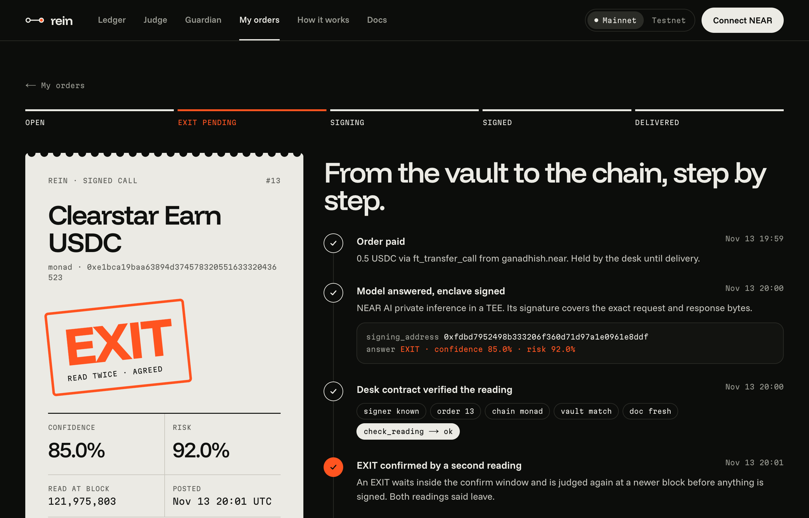
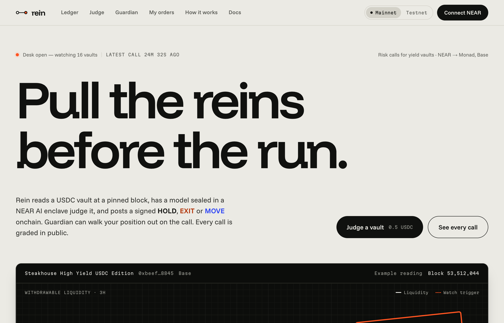
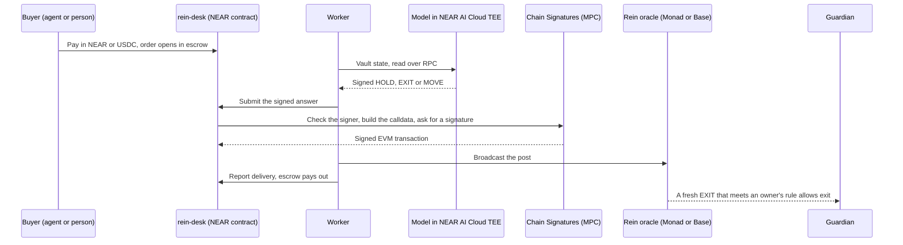
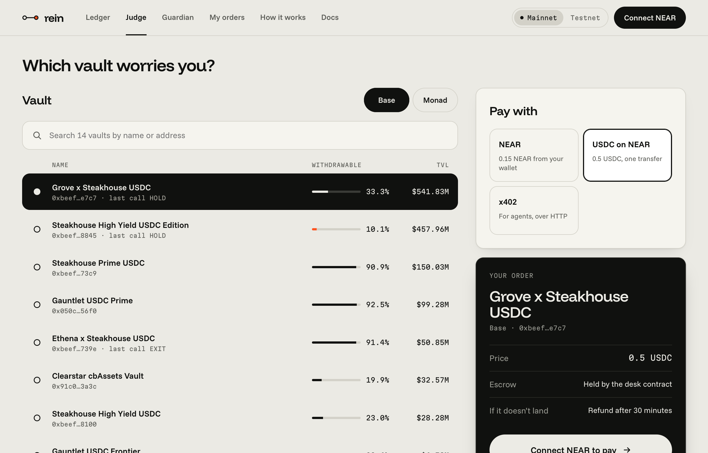
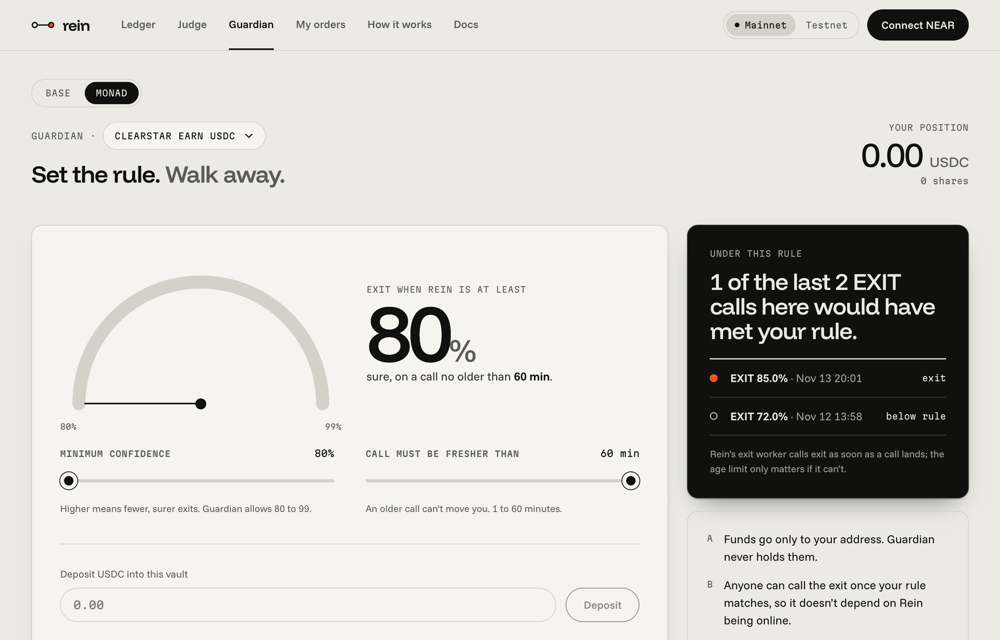

<div align="center">

<h1>Rein</h1>

<p><b>Agents pay Rein to judge a yield vault. A model in a NEAR AI TEE answers HOLD, EXIT or MOVE, and NEAR Chain Signatures posts the verdict to Monad or Base.</b></p>

<p>Signed by the TEE · Checked by the contract · Graded in public</p>

<p>


</p>

<p>
<a href="https://www.reinfi.xyz">Live app</a> ·
<a href="https://www.reinfi.xyz/ledger">Ledger</a> ·
<a href="#try-it">Try it</a> ·
<a href="docs/buy-with-an-agent.md">Agent walkthrough</a> ·
<a href="docs/reference.md">Reference</a>
</p>



</div>

> [!TIP]
> **Judges:** start with [Try it](#try-it). Steps 1 to 6 need no wallet, no key and no funds. [Follow the proof for one order](#follow-the-proof-for-one-order) walks one mainnet order from payment to the Guardian exit.

## Overview

Rein runs on a NEAR contract. An agent that manages stablecoins pays it to judge a yield vault, through one MCP tool call or an x402 payment over HTTP. A model inside a NEAR AI Cloud TEE reads the vault's onchain state and answers HOLD, EXIT or MOVE. The contract checks the model's signature, then NEAR Chain Signatures signs a transaction that posts the verdict to an oracle on Monad or Base. Every verdict is graded later on a public Ledger. A person can buy the same verdict in the browser.

Guardian is an optional contract on Monad and Base that acts on a verdict. A depositor sets a rule: a minimum confidence and a maximum verdict age. When a fresh EXIT on their vault meets the rule, anyone can call `exit`, and the position is redeemed straight back to its owner. Guardian never holds funds.

- Site: <https://www.reinfi.xyz> (mainnet; add `?network=testnet` for testnet)
- API: <https://api.reinfi.xyz> (mainnet), <https://api-testnet.reinfi.xyz> (testnet)
- Agent tools (MCP, streamable HTTP): `https://api.reinfi.xyz/mcp` and `https://api-testnet.reinfi.xyz/mcp`
- For agents: <https://www.reinfi.xyz/llms.txt>
- Guardian from code: the MCP tool `guardian_transactions` returns unsigned transactions to deposit into a vault and arm or disarm Guardian on Base or Monad; your wallet signs them.
- Built for NEAR HACKATHON, November 2026. Licence: MIT.

A verdict is advice. It is not a guarantee and it does not protect a position by itself.



## The problem

An agent that holds stablecoins in yield vaults cannot tell when a vault is turning risky, and neither can the person it works for. A model can give an opinion, but then the buyer has to trust whoever runs the model. The operator could change the answer, post it for a different vault, replay an old EXIT later, or take the payment and deliver nothing.

Rein is built so the operator cannot do those things. The Worker that runs the desk day to day holds a key that can only call eight methods on the contract. It cannot sign an EVM transaction, choose where a post goes, or move a customer's payment.

## How one order flows



Each post is graded later on the Ledger. An x402 buyer pays over HTTP instead of calling the contract; the rest is the same.

## What NEAR does

| NEAR piece                         | What Rein uses it for                                                                                                                                                                                                                           |
| ---------------------------------- | ----------------------------------------------------------------------------------------------------------------------------------------------------------------------------------------------------------------------------------------------- |
| Contract `rein-desk`               | Takes payment in NEAR or USDC, holds it in escrow, and pays a 70/30 treasury/agent split only when delivery is reported. It refunds in full if the post fails or the deadline passes.                                                           |
| NEAR AI Cloud (TEE)                | Runs `Qwen/Qwen3.6-35B-A3B-FP8` and signs each answer. The contract rebuilds the exact request from its own stored prompt, recovers the signer, and refuses anything not signed by an owner-approved TEE key.                                   |
| Chain Signatures (MPC)             | Signs the EVM transaction. The contract builds the calldata itself from the verified answer, so the oracle address, vault, verdict and expiry are not the agent's to choose. The oracle accepts posts only from the contract's derived address. |
| NEAR Intents, through PingPay x402 | Lets an agent on another chain pay in USDC without a NEAR account. Mainnet only.                                                                                                                                                                |

## Try it

Steps 1 to 6 need no wallet, no key and no funds.

1. **Open a delivered order.** Go to <https://www.reinfi.xyz/orders/20?network=testnet>. See a HOLD verdict and a "Verify this order" section that links the NEAR order, the exact document the model read, the TEE signer, and the Monad testnet transaction.
2. **Read the Ledger.** Run `curl https://api-testnet.reinfi.xyz/v1/ledger`. See `posts`, the `score` object with `n` and `brier`, and `recent` rows with `resolved`, `adverse` and `signer`. The same data is at <https://www.reinfi.xyz/ledger?network=testnet>.
3. **List the agent tools.** Run:

   ```sh
   curl -s -X POST https://api-testnet.reinfi.xyz/mcp \
     -H 'content-type: application/json' \
     -H 'accept: application/json, text/event-stream' \
     -d '{"jsonrpc":"2.0","id":1,"method":"tools/list"}'
   ```

   See six tools: `list_vaults`, `latest_verdict`, `get_verdict`, `order_status`, `ledger` and `guardian_transactions`.

4. **Verify a real TEE signature offline.** Clone the repository, then from `near/` run `cargo test -p desk --lib real_fixture_verifies`. See `1 passed`. The test feeds a recorded NEAR AI request, response and signature from `near/desk/tests/fixtures/near-ai-1.json` through the contract's own verification code, with no network.
5. **Compare Rein with simple forecasts.** From the repository root run `pnpm install`, then `pnpm baseline --check`. See `--check PASS` and a four-row table. Then run `pnpm baseline https://api.reinfi.xyz/v1/ledger` to score the live mainnet Ledger the same way; use `api-testnet` for testnet. This needs Node 22.6 or newer.
6. **Follow a mainnet Guardian exit.** Run `curl https://api.reinfi.xyz/v1/orders/13`. See an EXIT at 8500 bps on Monad's Clearstar USDC vault, then follow the table below to the exit transaction that returned the position to its owner.
7. **Buy a verdict with an agent.** Follow [docs/buy-with-an-agent.md](docs/buy-with-an-agent.md). You need a NEAR testnet account with about 0.2 NEAR. An MCP client such as Claude Code calls `get_verdict`, pays 0.1 NEAR, and gets the verdict and its proof links back in one tool call. Order 20 above was bought this way and took 49 seconds.
8. **Buy one in the browser.** Open <https://www.reinfi.xyz/judge?network=testnet>, connect a NEAR testnet wallet, pick a vault and pay. See the order move from open to delivered, then open its receipt.

   

## Follow the proof for one order

Order 13 on mainnet, paid in USDC from the operator's own NEAR account on 13 November, judged Monad's Clearstar USDC vault while one wallet had armed Guardian on it:


| Stage             | What to check                                                                                                                                           | Where                                                                                                            |
| ----------------- | ------------------------------------------------------------------------------------------------------------------------------------------------------- | ---------------------------------------------------------------------------------------------------------------- |
| Payment and order | 0.5 USDC `ft_transfer_call` to `rein-desk.near`; the contract logs `order 13 opened`                                                                    | [NEAR transaction](https://nearblocks.io/txns/C7CShiLQfxJKmY4yip1CwUp2pNiyCS2C2d6spzib6krn)                      |
| Document          | The `doc` string the model read: utilization 9,990 bps, 0.10% liquid. Its keccak256 is the posted `state_hash`, `0x3138…d37d`; `input_check` is `match` | `curl https://api.reinfi.xyz/v1/orders/13`, `posts[0]`                                                           |
| Model signature   | Both judge calls signed by `0xfdbd7952498b333206f360d71d97a1e0961e8ddf`, the Qwen TEE key in [attestations/](attestations)                              | Same response, `judge_calls`                                                                                     |
| EVM post          | EXIT, confidence 8500, risk 9200, sent to the Monad oracle by the desk's derived address `0x4235…ebB6`                                                  | [Monad transaction](https://monadscan.com/tx/0x4d2c1e6a6d458b4a740e88094910fcefff32ae990f3e012847503149a9c4acb1) |
| Guardian exit     | About two minutes later the Worker called `exit` on the Monad Guardian: 0.25 USDC back to the owner, 0 shares left                                      | [Monad transaction](https://monadscan.com/tx/0x644c51fa335e10a93c372ed439bd4cccfebfaaec2f6dc5003723f09536b85da7) |
| Grade             | Graded on the public Ledger after its window closed: resolved, not adverse                                                                              | `curl https://api.reinfi.xyz/v1/orders/13`, `posts[0]`                                                           |

The owner in that exit, `0xbc5d…cb50`, is also Rein's mainnet executor wallet, so onchain it reads as the owner exiting itself. The Worker signed and sent it; an exit for an owner who is not the executor has not been run yet.

On testnet, [order 20](https://www.reinfi.xyz/orders/20?network=testnet) was bought by an agent over MCP and shows the same chain from payment to grade.

## Attacks the contracts refuse

Each of these was run against the live testnet deployment. The output is committed.

| Attack                                                    | Result                      | Log                                            |
| --------------------------------------------------------- | --------------------------- | ---------------------------------------------- |
| Change one character of the model's answer                | `unknown signer`            | [docs/tamper.log](docs/tamper.log)             |
| Sign the answer with a different key                      | `unknown signer`            | [docs/tamper.log](docs/tamper.log)             |
| Replay a real signed reading on another order             | `wrong order`               | [docs/tamper.log](docs/tamper.log)             |
| Corrupt the signature's recovery byte                     | `bad signature`             | [docs/tamper.log](docs/tamper.log)             |
| Post the same verdict to the oracle twice                 | `StateAlreadyPosted`        | [docs/replay.log](docs/replay.log)             |
| Post a signed verdict after its expiry                    | `PostExpired`               | [docs/replay.log](docs/replay.log)             |
| Open 140 orders on one vault in 16.5 seconds from 20 keys | 1 order opened, 139 refused | [docs/burst-replay.log](docs/burst-replay.log) |

## What is live

As of 14 November 2026.

| Part                                                                        | Status                                                                               |
| --------------------------------------------------------------------------- | ------------------------------------------------------------------------------------ |
| Mainnet desk `rein-desk.near`, posting to Monad and Base                    | Live. 18 orders: 12 delivered, 6 rejected (explained below)                          |
| Testnet desk `rein-desk.testnet`, posting to Monad testnet and Base Sepolia | Live. 24 orders                                                                      |
| Site, public API and remote MCP                                             | Live on both networks                                                                |
| Agent purchase through MCP                                                  | Done on testnet (order 20)                                                           |
| x402 purchase through PingPay                                               | Done on mainnet (order 1, Monad August USDC V2). A forced failure has not been tried |
| Guardian automatic exits                                                    | Live on Monad and Base. One live exit on Monad (order 13)                            |
| Deposit and arm Guardian from the site                                      | Live on Base and Monad, at `/guardian`                                               |
| MOVE quote after an exit, to send the returned USDC elsewhere               | Code live. Not tried live                                                            |
| EXIT push alerts                                                            | Code merged and switched off                                                         |
| Grading                                                                     | Live on both networks                                                                |

Of the six rejected mainnet orders, two were paid. They failed on 12 November when the judge model then in use stopped returning answers, and the contract refunded both automatically; the judge has run on Qwen since. The other four were unpaid watch orders, which the desk opens for itself on vaults it monitors, so there was nothing to refund.



Mainnet addresses:

| Chain | Rein oracle                                  | Guardian                                     | Vaults it judges             |
| ----- | -------------------------------------------- | -------------------------------------------- | ---------------------------- |
| Monad | `0x6Ef1ca2A0c8B918429b78d8E9C8A8fc5F9970F1F` | `0x9BF96419e891A8509C8D49d5ec92AA730eBCC0FF` | 2 vaults (Clearstar, August) |
| Base  | `0xd535a4068265b383976d92718e3E650b5183b6Ab` | `0xe941433777B80eB559BaA2929C5b332e6E49a7d3` | 14 Morpho vaults             |

Testnet oracles: Monad testnet `0x16b998475d3c2b7FB5b794406701167039fD841A`, Base Sepolia `0xd535a4068265b383976d92718e3E650b5183b6Ab` (the same address as on Base). Both judge Rein's own mirror vaults: test vaults on mock USDC that copy a real vault's APY and utilization. All addresses are in [shared/deployments.ts](shared/deployments.ts).

Running cost: about $0.01 per Monad verdict and well under a cent per Base post in gas, plus about $0.0001 for the model. Deploying and running everything so far cost under $1 in gas and fees, plus $3 for the `reinfi.xyz` domain; about 3 NEAR is held as contract storage, which comes back when the contracts are removed.

## How good the verdicts are

The Ledger scores each verdict's risk forecast against what happened to the vault afterwards, using the Brier score, where lower is better. `pnpm baseline <ledger URL>` reproduces these tables. On 14 November:

| Forecast                                                                 | Mainnet (9 calls) | Testnet (9 calls) |
| ------------------------------------------------------------------------ | ----------------: | ----------------: |
| Rein                                                                     |             0.357 |             0.093 |
| Fixed rule: EXIT if utilization is at least 95% or liquidity is under 2% |             0.277 |             0.099 |
| Base rate, known only in hindsight                                       |             0.099 |             0.173 |
| Coin flip                                                                |             0.250 |             0.250 |

On mainnet, Rein has so far done worse than a coin flip and worse than the fixed rule. Nine calls is far too few to say much either way, and the testnet calls are on Rein's own mirror vaults. The table is here so anyone can rerun it as the sample grows.

## Trust limits

- A TEE signature proves which model produced an answer from which document. It does not prove the document's inputs were true. The Worker reads vault state over RPC and the contract cannot check it.
- The owner approves the model signers and the prompt, and the oracle trusts one attester address. Those are trust boundaries.
- The contract trusts the agent's delivery and failure reports and the gas fee it reports. It does not verify EVM receipt proofs.
- If a post lands but the Worker stays down past the post's expiry plus a grace period, a customer could get both the post and a refund.
- Confidence is not calibrated accuracy. The Ledger scores the risk forecast, not the confidence.
- "Adverse" is measured from asset decline and outflows. It is a proxy, not proof that a depositor lost money.
- x402 payments settle before the judgement and are not escrowed. If the judgement fails, the buyer gets one replacement judgement, not money back.
- Guardian exits need the owner to opt in, a fresh verdict, enough vault liquidity and a funded executor. A partial exit can leave funds in the vault.
- The Worker finds Guardian opt-ins from `Enabled` logs. On Base it reads them through three free public RPC endpoints in rotation, because Base makes five blocks a second; if all three refuse at once, discovery waits for the next minute's run.
- The one live mainnet exit so far was for an owner who is also Rein's executor wallet.

## Tests

| Suite                         | Command                                           |
| ----------------------------- | ------------------------------------------------- |
| Desk contract                 | `cargo test -p desk --lib` from `near/`           |
| Worker                        | `pnpm -C worker test`                             |
| Web                           | `pnpm -C web test`                                |
| MCP server                    | `pnpm -C mcp test`                                |
| Oracle, Guardian and adapters | `forge test --no-match-contract Fork` from `evm/` |
| Baseline self-check           | `pnpm baseline --check`                           |

[docs/reference.md](docs/reference.md#local-verification) has the desk sandbox tests, which need the wasm builds, and the live Base fork tests.

## Built with

- **NEAR:** Rust and `near-sdk` for the desk contract; `@near-js/accounts`, `crypto`, `providers` and `signers` in the Worker and MCP server.
- **EVM:** Solidity and Foundry, with OpenZeppelin contracts and `forge-std` vendored in `evm/lib`.
- **Worker:** TypeScript and Hono on Cloudflare Workers, with D1.
- **Web:** Next.js and React.
- **Shared:** `viem` for EVM encoding and hashing, `@modelcontextprotocol/sdk` for the MCP server, Vitest and Playwright for tests.

Exact versions are pinned in the lockfiles.

**Reused code.** The first commit vendors the risk oracle, the vault adapters and the grading code from [Tare](https://github.com/0xGanadhish/tare) at `b584c863`, under MIT. Tare is my earlier project on Monad and was written before this hackathon. Everything after that commit is hackathon work, including the NEAR contract, the Worker, the MCP server, the site, and the oracle's replay and expiry checks.

## More detail

- [docs/reference.md](docs/reference.md): order states, refunds, Worker recovery, the Ledger and health fields, the API and the x402 flow.
- [docs/buy-with-an-agent.md](docs/buy-with-an-agent.md): the agent buyer walkthrough.
- [docs/vaults.md](docs/vaults.md): which Base vaults Rein can grade, and why.
- [CONTRIBUTING.md](CONTRIBUTING.md): branches and code quality commands.
